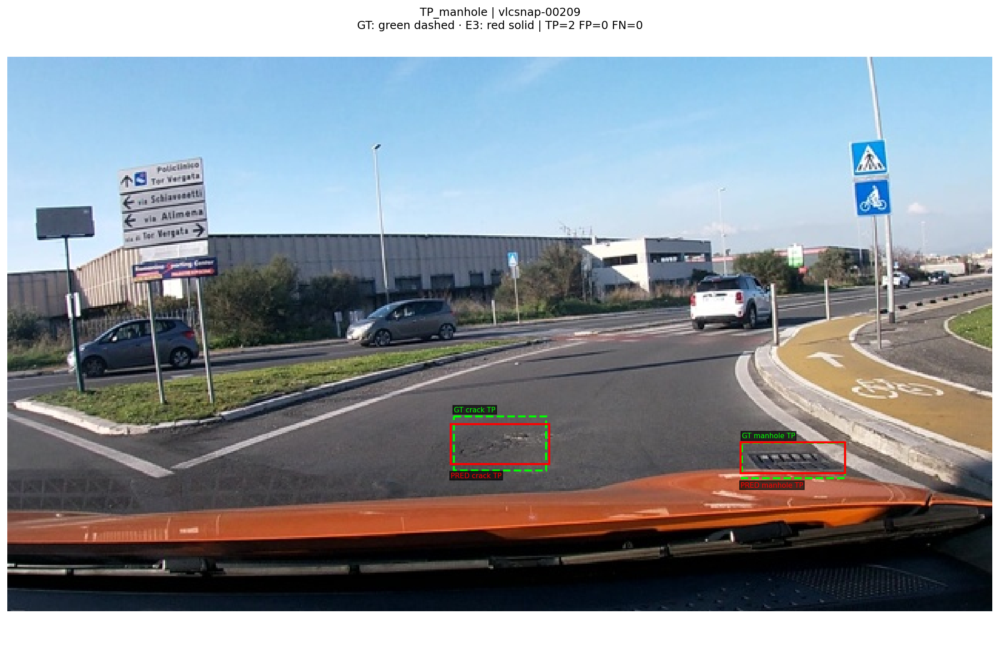
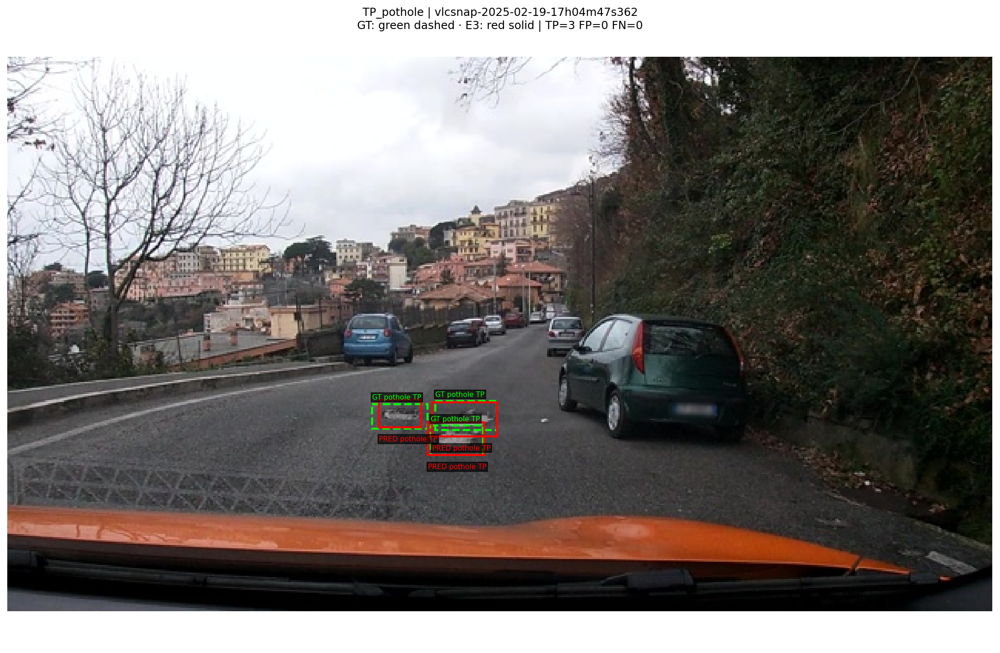
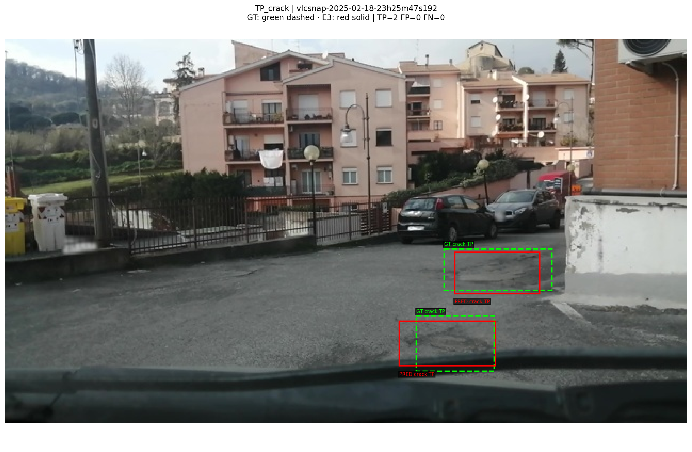
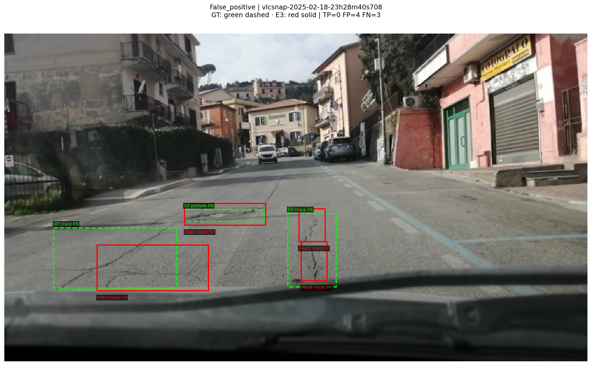
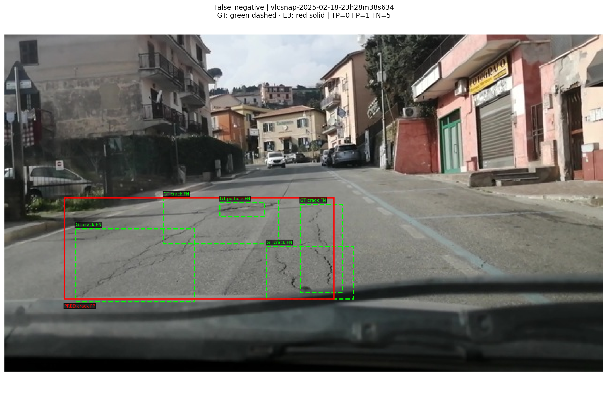
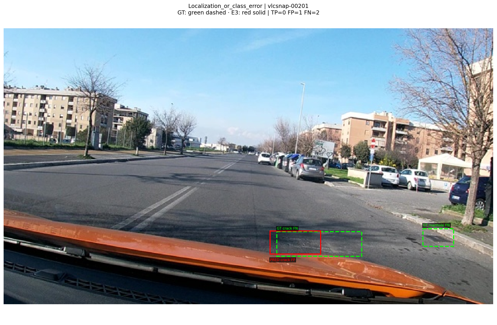

# Báo cáo Lab Day10 — Vision–Language Model

Họ tên: **Văn Thành Huy**  
MSSV: **2A202602763** · Bài cá nhân  
`dataset_version`: **d10-21e4070301**

> Đã có kết quả E0–E4, 6 ảnh minh họa và kiểm chứng sai thang tọa độ. Xem các giới hạn phương pháp và tái lập ở cuối báo cáo.

## Cấu hình và nguồn bằng chứng

**Cấu hình submission: tối đa 300 bước tối ưu**, Qwen/Qwen3-VL-4B-Instruct, NF4 4-bit cho LLM, ViT/lm_head không lượng tử hóa, LoRA rank 16/alpha 32/dropout 0,05, AdamW lr 2e-4, warmup 5%, cosine, seed 42. Kaggle có hai T4 nhưng code sử dụng GPU 0. E1 dùng batch 1 × accumulation 8; E2/E3/E4 dùng batch 2 × accumulation 4, cùng effective batch 8.

Theo thông tin người thực hiện cung cấp, BTC cho phép early stopping trong cấu hình tối đa 300 bước; báo cáo phân biệt cấu hình với cập nhật thực tế. E1/E2/E3 chính thức đều đã hoàn tất 300 cập nhật, không overflow. E4 giữ 275 cập nhật ở cả hai phía để khớp đối chứng E3 cũ, với lịch LR được lập cho 300 bước. Kết quả E3 chính thức mới là bản 300 bước, không phải bản 275 bước dùng làm đối chứng E4.

Số liệu lấy từ `report/evidence/*.json` do scorer gốc sinh, log Kaggle và predictions thực tế. Thời gian chỉ tính phần training được instrument, không gồm tải model và suy luận. VRAM dưới đây là peak allocated / 2^30 (GiB), không phải toàn bộ bộ nhớ GPU hoặc giá trị reserved.

## Bảng tổng hợp

| Mã | Tham số train | Bước thực tế | VRAM GiB | Phút | F1 | CI95 | FP/ảnh | Pothole F1 | Crack F1 | Manhole F1 |
|---|---:|---:|---:|---:|---:|---|---:|---:|---:|---:|
| E0 | 0 | 0 | 0.00 | 0.00 | 0.0615 | [0.0445; 0.0803] | 1.977 | 0.0721 | 0.0117 | 0.1148 |
| E1 | 33,030,144 | 300 | 5.03 | 49.37 | 0.2811 | [0.2430; 0.3208] | 1.016 | 0.1878 | 0.2121 | 0.5159 |
| E2 | 142,135,296 | 300 | 11.20 | 41.51 | 0.3494 | [0.3096; 0.3925] | 1.148 | 0.2128 | 0.2803 | 0.6320 |
| E3 | 148,426,752 | 300 | 7.92 | 46.17 | 0.4599 | [0.4176; 0.5005] | 0.871 | 0.3981 | 0.3684 | 0.7018 |
| E4 10% | 148,426,752 | 275 | 7.91 | 46.98 | 0.2636 | [0.2312; 0.2959] | 1.833 | 0.1705 | 0.1864 | 0.5395 |
| E4 100% (E3 cũ) | 148,426,752 | 275 | 7.92 | 44.22 | 0.4582 | [0.4152; 0.5013] | 0.971 | 0.3109 | 0.3987 | 0.7031 |

E0 không có training; các giá trị 0 ở cột thời gian/VRAM là không áp dụng cho training, không phải phép đo inference.

## Câu 1 — Kiến trúc và các khối được cập nhật

Theo quy mô tham khảo của đề, model khoảng 4,44B tham số: LLM + embedding khoảng 4,0B; ViT khoảng 415M, trong đó projector gồm merger khoảng 27M và deepstack mergers khoảng 82M. Đây là số xấp xỉ từ GUIDE, chưa phải phép đếm riêng toàn bộ model trong phiên chạy của tôi. Không cộng projector lần nữa ngoài ViT.

E1 cập nhật 33.030.144 tham số LoRA trên 252 module attention/MLP của LLM. E2 thêm toàn bộ projector: 142.135.296 − 33.030.144 = **109.105.152** tham số. E3 thêm LoRA ViT: 148.426.752 − 142.135.296 = **6.291.456** tham số, tổng 348 module LoRA. Adapter E3 local có 696 tensor LoRA A/B, tổng 39.321.600 phần tử; cộng projector ra đúng 148.426.752. Trọng số gốc LLM/ViT ngoài phần mở được đóng băng.

## Câu 2 — Lỗi của E0

E0 parse-valid rate **0,73955**: 230/311 output hợp lệ, 81 output không hợp lệ theo parser của đề. Trong 311 ảnh có 615 FP và 545 FN; đây là lỗi định vị/lớp tổng hợp theo scorer, chưa tách từng nguyên nhân bằng gán nhãn thủ công. Hai vấn đề quan sát được là output JSON hỏng/cắt dở và số box không khớp GT rất lớn. Không coi code fence là lỗi vì parser chấp nhận nó.

Ví dụ raw test `vlcsnap-00202` bắt đầu bằng các box crack liên tiếp và kết thúc dở tại `{"bbox_2d": [360, `; output không parse được. Nội dung đầy đủ nằm trong predictions local. Giới hạn 256 token là một nguyên nhân có thể làm cắt dở, nhưng chưa xác nhận stopping reason của từng ảnh. Smoke val cũng từng trả cùng box [10,500,50,520] cho cả ba lớp; đây là dấu hiệu output không đáng tin chứ chưa phải phép đối chiếu GT.

## Câu 3 — Thang tọa độ 0–1000

Với ảnh 640×360: x_pixel=x_norm×640/1000 và y_pixel=y_norm×360/1000. Ví dụ [100,500,200,600] tương ứng [64,180,128,216] pixel. Scorer mặc định coi output là norm1000; nếu đưa output norm1000 vào chế độ pixel, tọa độ được nhân thêm 1000/640 ở x và 1000/360 ở y, làm sai vị trí/kích thước, giảm IoU và thường giảm F1. Không có cơ sở khẳng định mọi box đều cho F1 bằng 0.

Đã chạy scorer gốc trên cùng 311 predictions E3 300 bước: `--coord norm1000` đạt **F1=0,4598738, TP=255**; đổi riêng chế độ chấm sang `--coord pixel` cho **F1=0, TP=0, FP=526, FN=583**, dù 100% JSON vẫn hợp lệ. Đây là kết quả đo trên tập này, không phải định lý mọi dữ liệu sai thang đều có F1=0. Bằng chứng: [đúng thang](report/diagnostics/e3_coord_norm1000.json), [sai thang](report/diagnostics/e3_coord_pixel.json). Không training hoặc điều chỉnh model trong phép kiểm chứng này.

## Câu 4 — Mask loss

Mỗi mẫu gồm user chứa ảnh/prompt và assistant chứa JSON target. Code kiểm tra token prompt là tiền tố chính xác của chuỗi đầy đủ, rồi đặt labels của prefix và padding bằng −100; chỉ phần assistant, gồm token kết thúc, được học. Với mẫu kiểm tra, vision token là 220. Pixel values và image_grid_thw được nối, không pad như chuỗi text.

Nếu tính loss trên prompt và token ảnh, mục tiêu sẽ gồm tái tạo cả input vốn đã biết; loss có thể giảm chủ yếu ở phần dễ này thay vì học grounding JSON. Mask không loại gradient đi qua encoder ảnh: ở E3, loss của câu trả lời vẫn backprop qua ViT LoRA. Chưa chạy ablation mask/no-mask nên đây là phân tích cơ chế, không phải kết quả thực nghiệm so sánh.

## Câu 5 — Projector, quantization và FP32

Không thể chỉ đổi requires_grad trên trọng số đóng gói 4-bit và coi đó là full fine-tuning projector. Adapter có thể học bên cạnh trọng số quantized, nhưng đề yêu cầu cập nhật chính trọng số projector. Tôi giữ các layer ViT và lm_head ngoài quantization bằng danh sách tên đầy đủ lấy từ cây model, đồng thời assert không còn Linear4bit/Linear8bitLt trong chúng.

Trong quá trình debug, bias merger đã đổi sang FP16 khi forward và GradScaler báo Attempting to unscale FP16 gradients. Code cuối nạp projector dạng Linear thông thường, giữ tham số đang tối ưu ở FP32, dùng autocast FP16 cho phép tính và GradScaler init_scale=1024. FP32 ở tham số giúp duy trì độ chính xác cập nhật và gradient tương thích scaler; không có nghĩa mọi phép tính projector đều chạy FP32 hoặc mọi phương pháp fine-tuning đều bắt buộc FP32. E1/E2/E3 chính thức đều ghi nhận 0 overflow.

## Câu 6 — Split theo phiên quay

Frame gần nhau trong cùng video rất giống nhau. Random split theo ảnh có thể để cùng cảnh ở train và test, khiến mô hình nhận lại cảnh đã thấy và làm đánh giá lạc quan. Script gốc gán toàn bộ session vào một split; notebook kiểm tra các tập session giao nhau rỗng.

| Split | Ảnh | Pothole box | Crack box | Manhole box |
|---|---:|---:|---:|---:|
| Train | 1422 | 1074 | 1750 | 691 |
| Val | 276 | 66 | 470 | 103 |
| Test | 311 | 121 | 299 | 163 |

Phân bố lớp lệch theo session, đặc biệt val chỉ 66 pothole. Không đổi split hoặc dùng test làm train. Audit train phát hiện một crack có h=0 ở vlcsnap-00058: bỏ riêng target này khi tạo đáp án, giữ ảnh và dữ liệu gốc. Box có diện tích dương bị suy biến khi làm tròn được mở tối thiểu một đơn vị nếu gặp; audit đã lưu.

## Câu 7 — So sánh E1/E2/E3

E1 nâng F1 từ E0 0,0615 lên 0,2811, tăng 0,2196; parse-valid đạt 98,71%, vượt 95%. E2 lên 0,3494 (+0,0684 so với E1), E3 lên 0,4599 (+0,1104 so với E2). E3 cho chất lượng cao nhất trong các lượt chính thức này, nhưng precision 0,4848 và recall 0,4374 vẫn còn thấp; không thể gọi là detector chính xác hoàn toàn.

Mở projector thêm 109,1M tham số; thêm LoRA ViT chỉ thêm 6,29M nhưng phải truyền gradient qua encoder. Vì các lượt dùng batch hình dạng khác nhau và trạng thái runtime khác, không dùng thời gian E2 41,51 phút so với E1 49,37 phút để khẳng định mở projector nhanh hơn. VRAM E3 log 7,92 GiB thấp hơn E2 11,20 GiB và benchmark E3 cũ 10,72 GiB; cần phép đo trong runtime thống nhất trước khi kết luận tiết kiệm bộ nhớ. Về lựa chọn thực dụng: E1 nhẹ nhất theo số tham số, E3 tốt nhất theo F1 đã đo.

## Câu 8 — Khoảng tin cậy và giới hạn

CI95 F1 của E1 rộng khoảng 0,0778; E2 0,0829; E3 0,0829. E1/E2 có phần giao nhau, trong khi CI E2/E3 chính thức tách nhau. Chồng lấn hoặc không chồng lấn hai CI riêng không thay thế kiểm định paired trên chênh lệch F1; muốn kết luận mạnh hơn cần paired bootstrap cùng ảnh.

Scorer bootstrap trên 311 ảnh; các frame trong một session vẫn tương quan. Vì vậy bất định theo session có thể lớn hơn CI theo ảnh. Các kết quả là một seed, một cách chia và một dataset; không suy rộng thành bảo đảm trên mọi dashcam. Tôi đã xem test qua nhiều lượt nên cần công khai yếu tố lựa chọn setup sau đánh giá, không coi test còn là một đánh giá hoàn toàn mù.

## Câu 9 — Lỗi theo lớp và minh họa

Ở E3 300 bước, crack có F1 thấp nhất **0,3684** (TP112/FP197/FN187), pothole **0,3981** (TP43/FP52/FN78), manhole **0,7018** (TP100/FP22/FN63). Crack tạo nhiều FP nhất. Vết nứt mảnh, kéo dài và box có thể bao nền lớn, nên sai lệch nhỏ ảnh hưởng IoU; nắp cống thường có hình dạng rõ hơn. Đây là giả thuyết giải thích, cần đối chiếu các ảnh cụ thể; không khẳng định đã đo kích thước từng lớp.

Đã xuất 6 ảnh từ predictions E3 300 bước. **GT xanh lá nét đứt, prediction đỏ nét liền**; TP yêu cầu cùng lớp và IoU ≥0,5. Ảnh được chọn có chủ đích để giải thích lỗi, không phải mẫu ngẫu nhiên để ước lượng hiệu năng. Manifest lưu box, cặp ghép và IoU; SHA256 predictions khớp bản local.

**TP_manhole — `vlcsnap-00209`:** TP=2, FP=0, FN=0.

**TP_pothole — `vlcsnap-2025-02-19-17h04m47s362`:** TP=3, FP=0, FN=0.

**TP_crack — `vlcsnap-2025-02-18-23h25m47s192`:** TP=2, FP=0, FN=0.

**False_positive — `vlcsnap-2025-02-18-23h28m40s708`:** TP=0, FP=4, FN=3.

**False_negative — `vlcsnap-2025-02-18-23h28m38s634`:** TP=0, FP=1, FN=5.

**Localization_or_class_error — `vlcsnap-00201`:** TP=0, FP=1, FN=2.

## Câu 10 — E4: 10% so với 100% dữ liệu

Chọn data_size trên setup E3, giữ rank16/seed42/lr2e-4/batch2×accum4, cùng 275 cập nhật và lịch LR 300 bước. Lượt 10% lấy 142 ảnh sau shuffle seed42 và lưu danh sách image_id. Phía 100% dùng 1422 ảnh, tái sử dụng E3 cũ 275 bước (F1 0,4582), có hash nguồn trong metadata; không thay bằng E3 mới 300 bước vì sẽ đổi thêm số cập nhật.

10% đạt F1 0,2636, CI95 [0,2312;0,2959]; 100% đạt 0,4582, CI95 [0,4152;0,5013], chênh lệch 0,1946. FP/ảnh tăng từ 0,971 lên 1,833 khi chỉ dùng 10%. Loss train của lượt 10% cuối còn 0,00477 nhưng test kém: phù hợp với hiện tượng ghi nhớ tập nhỏ/overfitting, chưa chứng minh đây là nguyên nhân duy nhất.

Cùng 2200 lượt ảnh ở 275 cập nhật: mỗi ảnh trong tập 142 ảnh được gặp nhiều hơn; giảm dữ liệu không đồng nghĩa giảm compute. Lượt 10% mất 46,98 phút, đối chứng cũ 44,22 phút. Early stopping của đối chứng quyết định mốc 275; lượt 10% được cố định tại mốc đó và không dùng early stopping. Đây là so sánh sau khi chọn setup và mốc dừng, không phải thí nghiệm đăng ký trước; cần ghi giới hạn selection bias. Hai CI tách nhau gợi ý khác biệt lớn trong phép đo này, không thay kiểm định paired hoặc nhiều seed.

## Nhìn lại và việc còn lại

Các lỗi đáng học gồm target zero-area, lượng tử hóa nhầm projector, gradient FP16 và torchao không tương thích. Loss thấp không đồng nghĩa grounding tốt; cần scorer IoU và ảnh trực quan. E5 GRPO không thực hiện.

Ảnh minh họa và phép kiểm chứng tọa độ đã hoàn tất. Đã lưu checkpoint E1/E2/E3 chính thức 300 bước tại local trong work/checkpoints, ngoài Git. Log trong checkpoint E2/E3 khớp log của kết quả test tương ứng; E2/E3 có adapter và projector.pt riêng. Checkpoint E3 275 bước dùng làm đối chứng E4 được lưu riêng, không nhầm với bản 300 bước. Checkpoint không chứa optimizer state nên chỉ hỗ trợ nạp để inference, không resume training chính xác. Không commit trọng số. Kiểm tra Git/submission cuối được ghi riêng, không coi checker tự động là bằng chứng mọi tiêu chí nội dung đã đạt.

Mã và bản nháp báo cáo có hỗ trợ từ Codex. Tất cả số liệu kết quả nêu trên lấy từ output Kaggle do người thực hiện cung cấp; phần phân tích cơ chế được tách khỏi thí nghiệm chưa chạy.
